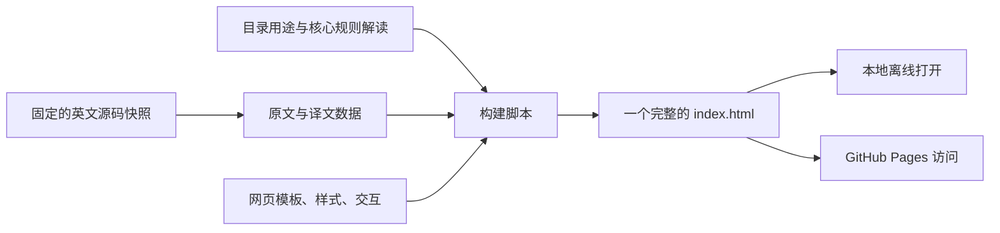

# 这个学习网站怎样组成

本项目是一个离线阅读器，研究对象是 `source/superpowers/` 中的上游源码。两者分开存放，避免把网页的运行逻辑与被研究的 Skill 规则混在一起。

1. **来源层**：`source/superpowers/` 保留固定提交的原始文件。源码只供展示与核验，不作为网站服务执行。
2. **内容层**：`content/` 记录逐段译文、原文行号、每个文件的用途以及核心 Skill 解读。译文修正独立保存，可以重新构建。
3. **界面层**：`app/` 的模板、CSS 和 JavaScript 负责目录树、项目地图、搜索、逐段对照及仿写下载。原文作为文本显示，网页不执行源码中的 HTML 或命令。
4. **成品层**：`scripts/build.py` 把内容和界面装入 `index.html`。读者不需要运行 Python、不需要服务端，也不需要在线翻译接口。

## 为什么交付单个 HTML

用户先本地学习，再发布到网上。内置内容可以直接双击打开，避免本地浏览器读取独立 JSON 时的权限问题，也省去部署后路径找不到文件的问题。页面内部使用 `#` 地址定位，兼容 GitHub Pages 的仓库子路径。

代价是首次打开需要读取整份内容，文件比普通网页大。默认只展示当前文件的 15 个语段，按需继续展开，减少长文的页面负担。

## 内容可信度

- 英文源码和提交信息是来源。
- 中文释义是机器翻译辅助产物，AI 修正重点段落并提供解释。
- “做什么／为什么／怎么借鉴”属于教学归纳，不能当作官方规范。
- 历史设计文档有专门提示；不同平台的接入方式分别展示。

## 更新路径

修改 `app/` 或中文解读数据后，运行构建脚本与内容检查即可。更新上游快照还需要重新分块和翻译，并重新核对统计。当前完整性检查固定为本次 238 个文件的快照，换版本时也需相应调整。
